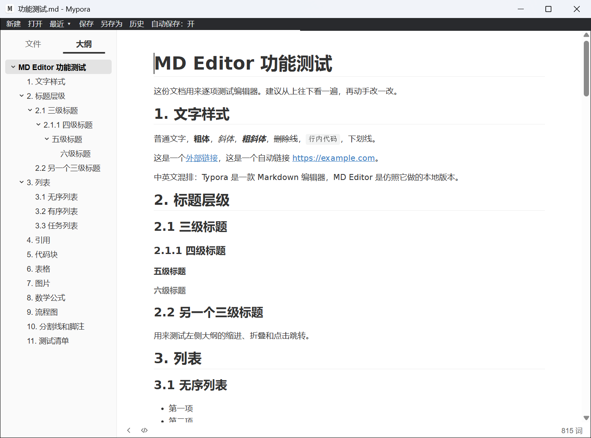

<p align="center">
  
</p>

<h1 align="center">Mypora</h1>

<p align="center">
  免费版typora，破解版typora，自己纯手搓复刻typora功能
</p>
<p align="center">
  轻量的本地 Markdown 编辑器，界面和操作仿 Typora。安装包约 7MB，完全离线。
</p>

<p align="center">
  <a href="https://github.com/tongxt2644531/Mypora/releases/latest"><b>⬇ 下载最新版（Windows）</b></a>
</p>



## 下载安装

1. 打开 [Releases 页面](https://github.com/tongxt2644531/Mypora/releases/latest)，下载 `Mypora_x.x.x_x64-setup.exe`
2. 双击安装（中文安装界面）
3. 安装后可以把 `.md` 文件的默认打开方式设为 Mypora：右键 `.md` 文件 → 打开方式 → 选择 Mypora，勾选"始终使用"

系统要求：Windows 10 / 11（64 位）。Windows 11 自带运行需要的 WebView2；Windows 10 如果没有，安装程序会自动下载。

## 功能

**编辑**
- 即时渲染编辑；标题不展开 `##`，Ctrl+1～6 设置标题级别、Ctrl+0 变回段落
- 代码块：行号、语法高亮，点击直接在高亮代码上编辑，右下角可改语言
- 表格工具栏：调整行列、对齐、插入/删除行列、删除表格
- `/` 快捷插入（`/dmk` 代码块、`/bg` 表格、`/yjbt` 一级标题……）
- 粘贴或拖入图片：自动存到文档旁边的 `assets` 文件夹
- Ctrl+点击链接：网址用浏览器打开，相对路径的 .md 在编辑器里打开，`#标题` 跳转
- 查找替换 Ctrl+F / Ctrl+H
- 源码模式（Ctrl+/ 或左下角 `</>`）：CodeMirror 编辑原文（行号、着色），右侧对比预览，按章节同步滚动

**文件**
- 新建窗口 Ctrl+N、打开 Ctrl+O、保存 Ctrl+S、另存为 Ctrl+Shift+S、最近打开
- 自动保存；关闭或切换文件前有未保存内容会提示
- 历史版本：打开和保存时自动留快照（同一文件最多每 5 分钟一份，保留 100 份），可查看和恢复
- 外部修改提醒：文件被其他程序改动时自动重新载入，或询问用哪个版本
- 只运行一个程序：已经开着时双击 .md 在主窗口打开

**侧边栏**（Ctrl+Shift+L 或左下角 `<`）
- 文件树：右键新建、重命名、删除（进回收站）、在资源管理器中显示、复制路径；文件夹变化自动刷新
- 大纲：点击跳转，滚动时高亮当前章节，可折叠

## 开发

需要 Node.js、Rust、VS C++ 生成工具（Win11 自带 WebView2）。

```bash
npm install          # 会自动把 Vditor 资源复制到 public/vditor
npm run tauri dev    # 开发运行
npm run tauri build  # 打包，产物在 src-tauri/target/release/bundle/nsis/
```

## 结构

| 文件 | 内容 |
|---|---|
| `src/main.js` | 主流程：编辑器、文件操作、侧边栏、文件树、自动保存、外部修改检测 |
| `src/source.js` | 源码模式（CodeMirror + 预览 + 同步滚动 + 源码大纲） |
| `src/table.js` | 表格工具栏 |
| `src/heading.js` | 标题保持静态、Ctrl+0～6 |
| `src/slash.js` | `/` 快捷插入菜单 |
| `src/find.js` | 渲染模式查找替换 |
| `src/images.js` | 粘贴 / 拖入图片 |
| `src/history.js` | 历史版本 |
| `src/links.js` | 链接点击 |
| `src/treemenu.js` | 文件树右键菜单 |
| `src/style.css` | 全部样式 |
| `src-tauri/src/lib.rs` | 读写文件、文件树、文件夹监听、单实例、多窗口 |
| `src-tauri/src/files.rs` | 图片保存、历史版本、文件新建/重命名/删除 |
| `src-tauri/tauri.conf.json` | 窗口、打包、.md 文件关联 |

程序内部标识仍是 `com.local.mdeditor`，设置、历史版本和窗口位置都按它存放，改名不影响已有数据。

## 致谢

- [Tauri](https://tauri.app/) —— 桌面应用框架
- [Vditor](https://github.com/Vanessa219/vditor) —— Markdown 即时渲染编辑器
- [CodeMirror](https://codemirror.net/) —— 源码模式编辑器
- 界面和交互参考了 [Typora](https://typora.io/)

## 许可证

[Apache-2.0](LICENSE)

## 欢迎打赏作者

如果 Mypora 对你有帮助，欢迎请作者喝杯咖啡 ☕

<p align="center">
  
</p>
